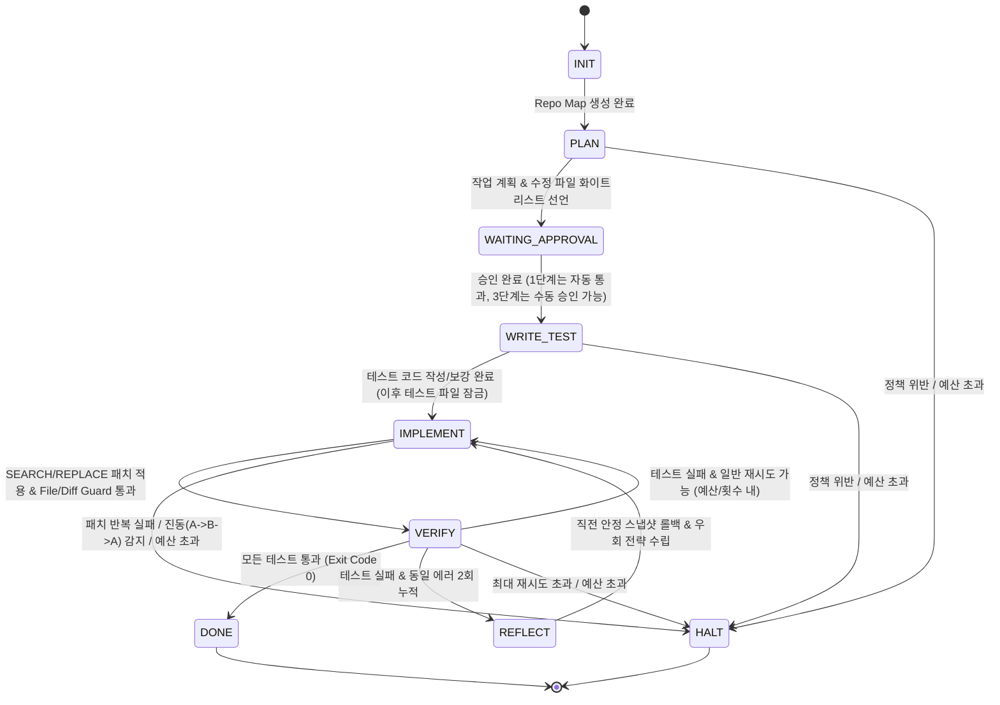

# Agent Forge: 단계별 확장형 AI 하네스 엔지니어링 설계 문서

- **작성일:** 2026-10-28
- **대상 범위:** 전체 1·2·3단계 확장 아키텍처 정의 및 **1단계(Agent Forge 코어 자율 개발 루프) 상세 설계**

---

## 1. 배경 및 목적 (Intent & Why)

현업에서 레거시 Java/JSP 기반 웹사이트를 유지보수하거나 기능을 개발할 때, 단순히 AI에게 코드 생성을 맡기면 다음과 같은 문제가 반복해서 발생한다.
1. 수정하지 말아야 할 파일까지 건드리거나 기존 코드를 의도치 않게 훼손함
2. 테스트가 실패할 때 구현 코드를 고치는 대신 테스트 코드를 느슨하게 조작(치팅)하여 통과시킴
3. 동일한 컴파일/테스트 오류를 같은 방식으로 반복 수정하며 API 토큰과 시간만 소모함
4. 화면(JSP/HTML/CSS)이나 기존 기능이 깨졌는지 검증하지 않은 채 수정을 완료 처리함

이 프로젝트의 목적은 고가 LLM의 추론 능력에만 기대는 것이 아니라, **가성비 모델(DeepSeek API)을 사용하더라도 정교한 '하네스 엔지니어링(Harness Engineering)'—파일 접근 통제, 테스트 게이트 잠금, 에러 지문 기반 루프 차단, 예산 통제, Git·DB 원자적 상태 복구—을 통해 안전하고 검증된 자율 개발을 달성할 수 있음을 증명하는 것**이다.

나아가 단발성 토이 프로젝트에 그치지 않고, **하나의 일관된 아키텍처 위에서 1단계(코어 자율 개발 루프) → 2단계(레거시 웹·JSP 시각 회귀 검증) → 3단계(GitHub 이슈·체크포인트 재실행·PR 자동화)**로 코드 재작성 없이 확장해 나간다.

---

## 2. 프로젝트 규모 및 단계별 로드맵 (Size & Phased Roadmap)

이 작업은 세 개의 단계로 이루어진 장기 프로젝트를 한 단계씩 완성해 나가는 구조다. **이번 설계 및 첫 구현의 범위는 '1단계 완성 + 2·3단계를 위한 확장 인터페이스 및 공통 타깃 샘플 레포 구축'**이다.

| 단계 | 프로젝트 명칭 | 핵심 목표 | 아키텍처 확장 방식 |
|---|---|---|---|
| **1단계 (현재 범위)** | **Agent Forge (자율 개발 루프)** | 한국어 요구사항 입력 → 작업 분해 → 테스트·코드 작성 → 테스트 게이트 통과 시까지 안전하게 자율 수정·재시도 | 코어 상태 머신(FSM) + `SubprocessTestVerifier` + SQLite 체크포인트 로거 + CLI (완성 후 경량 대시보드 연결) |
| **2단계 (차기 확장)** | **AI 웹사이트 유지보수 에이전트** | 레거시 웹(Java/JSP/HTML/CSS) 수정 후 브라우저 렌더링, 기존 기능 회귀 테스트, 전후 스크린샷 비교 검증 | 코어 루프 변경 없이 `Verifier` 플러그인에 `PlaywrightVisualVerifier` 추가 및 JSP/CSS 탐색 규칙 확장 |
| **3단계 (최종 확장)** | **개인 프로젝트 운영 자동화 에이전트** | GitHub 이슈 수집 → 단계별 인간 승인(Human-in-the-loop) → 중단 시 마지막 성공 단계부터 재실행 → PR 초안 생성 | 1단계에서 구축한 SQLite 체크포인트 위에 `WAITING_APPROVAL` 상태 활성화 및 GitHub Issue/PR 어댑터 결합 |

---

## 3. 목표, 비목표, 절대 금지 조건 (Goals, Non-Goals, Anti-Goals)

### Goals (1단계 달성 목표)
1. **한국어 태스크 기반 자율 루프:** 사용자가 한국어로 기능 추가·버그 수정을 요청하면 `[계획 및 파일 선언] → [테스트 작성/보강] → [구현 및 검증 루프]`를 자율 수행한다.
2. **테스트 치팅 원천 차단:** 구현 단계(`IMPLEMENT`)에 진입하는 즉시 하네스가 테스트 디렉토리/파일을 Read-Only로 잠가, AI가 테스트를 수정해 통과시키는 치팅을 물리적으로 차단한다.
3. **안전한 코드 편집 (`SEARCH / REPLACE`):** 줄 번호 오류에 취약한 Unified Diff 대신 `SEARCH / REPLACE` 블록 치환 방식을 사용하고, 적용 직후 `git diff`로 변경 파일·라인 수를 사후 검증한다.
4. **지능형 루프 & 예산 브레이크:**
   - **에러 지문(Error Fingerprint) 비교:** 동일한 에러가 2회 연속 발생하면 단순 재시도를 막고 직전 스냅샷 롤백 및 반성(Reflection) 프롬프트로 강제 전환한다.
   - **Diff 진동(Oscillation) 감지:** 수정 결과 파일 트리 해시가 과거 시도의 해시와 일치(`A → B → A`)하면 즉시 중단한다.
   - **예산(Budget) 하드 캡:** 태스크당 최대 토큰/비용($), 최대 재시도 횟수, 최대 수정 파일 수를 넘으면 안전하게 정지(`HALT`)한다.
5. **Git + SQLite 원자적 체크포인트:** 모든 단계 전이와 시도(Attempt)마다 Git 스냅샷과 SQLite 상태를 동기화 기록하여, 어느 시점으로든 즉시 롤백하거나 상태를 조회할 수 있게 한다.
6. **포트폴리오 시연용 테스트베드 구축:** 현업 Java/JSP 환경을 모사한 오픈소스용 샘플 프로젝트(`targets/legacy-jsp-app`)와 의도된 검증 시나리오(정상 해결, 재시도 해결, 치팅 차단, 무한루프 차단, 권한 위반 차단)를 함께 구축한다.

### Non-Goals (1단계에서 하지 않을 것)
- **초기 화려한 웹 UI 구축:** 1단계 코어 엔진이 완벽히 검증되기 전에는 CLI에 집중한다. 대시보드는 1단계 코어 완성 후 SQLite 실행 로그를 시각화하는 경량 뷰어로 덧붙인다.
- **Playwright 시각 회귀 비교:** 브라우저 렌더링과 스크린샷 비교는 2단계에서 구현하며, 1단계에서는 `Verifier` 추상 인터페이스만 마련해 둔다.
- **GitHub API 연동 및 PR 자동 생성:** 3단계에서 구현하며, 1단계에서는 로컬 Git 브랜치 격리와 체크포인트 상태 저장까지만 담당한다.

### Anti-Goals (기술적으로 동작하더라도 실패로 간주하는 조건)
- 에이전트가 테스트 통과를 위해 기존 테스트 케이스의 `assert` 문을 삭제·완화하거나 `@Disabled`/`skip` 처리하는 행위가 통과되는 것.
- 계획 단계에서 선언(화이트리스트 등록)하지 않은 파일을 수정하거나 타깃 워크스페이스 외부 경로에 접근하는 것.
- 동일한 컴파일 에러나 테스트 실패를 전략 변경 없이 최대 횟수까지 무의미하게 반복하며 API 비용을 낭비하는 것.
- 무거운 외부 프레임워크 블랙박스 뒤에 핵심 통제 로직이 숨어, 하네스가 어떻게 제동을 걸고 복구하는지 코드로 설명하기 어려워지는 것.

---

## 4. 제약 조건 (Constraints)

- **구현 언어 및 환경:** Python 3.11+ (`pydantic`, `sqlite3`, `openai` SDK, `typer`/`rich` 기반 CLI)
- **LLM API:** 가성비 확보를 위해 **DeepSeek API (`deepseek-chat` / `deepseek-reasoner`)**를 기본으로 사용하되, OpenAI 호환 클라이언트 래퍼로 추상화하여 환경변수 변경만으로 Claude, OpenAI, 로컬 모델(Ollama)로 전환 가능해야 한다.
- **보안 및 라이선스:** 사내 코드는 일절 포함하지 않으며, 포트폴리오 공개가 가능한 자체 제작 샘플 레포지토리만 저장소에 포함한다.
- **실행 환경:** macOS/Linux 로컬 서브프로세스 실행을 기본으로 지원하고, 타깃 빌드/테스트 환경 격리를 위한 Docker 컨테이너 실행 래퍼를 옵션으로 제공한다.

---

## 5. 아키텍처 접근법 비교 및 결정 (Approaches)

### 검토한 3가지 접근법
1. **접근법 A: 순수 Python + Pydantic 기반 자체 경량 상태 머신(FSM) + 플러그인 구조 (채택)**
   - 외부 에이전트 프레임워크 없이 명시적인 상태 전이 엔진과 SQLite 체크포인터를 직접 구현하고, `Verifier`와 `Trigger`를 플러그인 인터페이스로 분리한다.
2. **접근법 B: LangGraph 기반 그래프 워크플로 구조**
   - 각 단계를 LangGraph Node/Edge로 정의하고 내장 `SqliteSaver`를 사용한다.
3. **접근법 C: 이벤트 드리븐(Event-Driven) 비동기 워커 파이프라인**
   - 단계별 이벤트를 메시지 큐로 주고받는 워커 구조로 설계한다.

### 채택 이유 (왜 접근법 A인가?)
- **Git 워킹트리와 DB 상태의 원자적(Atomic) 동기화:** 코딩 하네스는 상태 전이나 롤백 시 메모리 변수만 바꾸는 것이 아니라 **실제 파일 시스템(Git 브랜치/커밋 스냅샷)과 파일 읽기 전용 잠금, SQLite 로그를 한 트랜잭션처럼 묶어 제어**해야 한다. 자체 FSM 클래스에서 `transition()`과 `rollback_to_attempt()`를 직접 통제하는 것이 버그가 가장 적고 명확하다.
- **타입 안정성과 투명성:** Aider, SWE-agent 등 검증된 오픈소스 코딩 하네스들과 동일한 철학으로, `Pydantic` 모델을 통해 복잡한 실행 상태(Diff 해시 히스토리, 에러 지문, 토큰 예산 등)를 명확하게 검증하고 포트폴리오에서 100% 자체 엔지니어링 역량을 보여줄 수 있다.

---

## 6. 상세 시스템 설계 (Detailed Design)

### 6.1 디렉토리 구조 (`/Users/woong/workspace/autoDev`)

```text
autoDev/
├── agent_forge/                 # 하네스 엔진 본체 (Python 패키지)
│   ├── cli.py                   # Typer/Rich 기반 CLI 엔트리포인트
│   ├── config.py                # 예산, 재시도 정책, 모델 설정 (Pydantic)
│   ├── core/
│   │   ├── state.py             # FSM 상태 정의 및 Run/Attempt 데이터 모델
│   │   ├── engine.py            # 상태 머신 실행 루프 및 전이 제어기
│   │   ├── store.py             # SQLite 체크포인트 저장소 (3단계 Resume 겸용)
│   │   └── git_ops.py           # 브랜치 격리, 스냅샷 커밋, 원자적 롤백, diff 추출
│   ├── harness/
│   │   ├── repo_map.py          # 타깃 프로젝트 디렉토리 및 심볼 시그니처 요약기
│   │   ├── file_guard.py        # 화이트리스트 검증 및 단계별 테스트 파일 Read-Only 잠금
│   │   ├── patcher.py           # SEARCH / REPLACE 블록 파서 및 퍼지 매칭 패처
│   │   ├── loop_guard.py        # 에러 지문(Fingerprint) 추출 및 Diff 해시 진동 감지
│   │   └── budget_guard.py      # 토큰 사용량, API 비용, 최대 변경 라인/파일 수 감시
│   ├── llm/
│   │   ├── client.py            # DeepSeek / OpenAI 호환 API 클라이언트 및 토큰 계산
│   │   └── prompts.py           # 단계별(PLAN, WRITE_TEST, IMPLEMENT, REFLECT) 프롬프트
│   └── verifiers/
│       ├── base.py              # Verifier 추상 인터페이스 (1·2단계 공통 규격)
│       ├── test_runner.py       # 1단계: Pytest / Gradle / Maven 서브프로세스 & Docker 실행기
│       └── playwright_stub.py   # 2단계 확장용 인터페이스 스텁
├── targets/
│   ├── python-mini-calc/        # 빠른 기능 검증 및 벤치마크용 경량 Python 타깃 프로젝트
│   └── legacy-jsp-app/          # 1·2단계 공통 데모용 Spring Boot + JSP 샘플 프로젝트
└── tests/                       # 하네스 자체의 동작(치팅 차단, 루프 감지, 패처 등) 단위/통합 테스트
```

### 6.2 상태 머신(FSM) 흐름 및 단계 정의

하나의 작업(`Run`)은 아래의 명시적 상태를 따라 이동하며, 매 상태 전이 직전과 직후에 `SQLite`와 `Git` 스냅샷이 기록된다.



### 6.3 6대 하네스 핵심 메커니즘 명세

#### ① Repo Map 생성 및 파일 화이트리스트 선언 (`PLAN` 단계)
- 하네스가 타깃 저장소의 파일 트리와 주요 클래스/메서드/함수 시그니처를 추출해 경량 `Repo Map` 텍스트를 생성한다.
- LLM은 한국어 요구사항과 `Repo Map`을 읽고 다음 구조화 출력(JSON)을 반환해야 한다:
  - `subtasks`: 세분화된 작업 단계 설명
  - `target_source_files`: 수정할 구현 파일 경로 목록 (최대 기본 5개 제한)
  - `target_test_files`: 추가하거나 보강할 테스트 파일 경로 목록
- 하네스의 `FileGuard`는 이 목록을 해당 Run의 **유일한 수정 허용 화이트리스트**로 등록한다.

#### ② 단계별 파일 잠금 및 테스트 치팅 방지 (`WRITE_TEST` → `IMPLEMENT`)
- **`WRITE_TEST` 단계:** `target_test_files`만 수정이 허용되며, 구현 파일 수정은 차단된다. (기존 테스트로 충분한 경우 새 검증 케이스만 추가하거나 건너뛰기 가능하되, 기존 `assert` 삭제 시도는 `FileGuard`가 Diff 검사로 거부한다.)
- **`IMPLEMENT` 단계 진입 순간:** 하네스는 모든 테스트 파일(`test/`, `src/test/` 및 `target_test_files`)을 **수정 불가(Read-Only)** 상태로 전환한다.
- 만약 `IMPLEMENT` 단계에서 에이전트가 테스트 파일을 수정하는 패치를 제출하면, `FileGuard`가 패치 적용을 즉시 거부하고 경고를 반환한다.

#### ③ `SEARCH / REPLACE` 퍼지 패처 및 사후 Diff 게이트 (`patcher.py`)
- 에이전트는 아래와 같은 블록 포맷으로만 코드 수정을 요청한다:
  ```text
  FILE: src/main/java/com/example/BoardService.java
  <<<<<<< SEARCH
  public List<Post> findPosts(String keyword) {
      return postRepository.findAll();
  }
  =======
  public List<Post> findPosts(String keyword) {
      if (keyword == null || keyword.isBlank()) {
          return postRepository.findAll();
      }
      return postRepository.findByTitleContaining(keyword.trim());
  }
  >>>>>>> REPLACE
  ```
- **3단계 매칭 전략:** (1) 정확 일치 매칭 → (2) 줄 끝 공백 무시 매칭 → (3) 들여쓰기 상대 오프셋 보정 매칭 순으로 시도하여 모델의 사소한 공백 실수를 보정한다. 매칭되는 블록이 없거나 2개 이상(모호함)이면 파일을 건드리지 않고 명확한 위치 컨텍스트 재요청 에러를 반환한다.
- **사후 `git diff` 게이트:** 패치 적용 후 `git diff --numstat`을 실행해 (a) 화이트리스트 외 파일이 변경되었는지, (b) 단일 시도 최대 변경 줄 수(예: 200줄)를 초과했는지 검사하고, 위반 시 즉시 `git checkout -- .`으로 원복한다.

#### ④ 루프 감지기: 에러 지문 & Diff 진동 차단 (`loop_guard.py`)
- **에러 지문(Error Fingerprint):** 테스트 실패 로그에서 타임스탬프, 메모리 주소, 임시 경로 등 가변 문자열을 정규식으로 제거하고 `(실패한 테스트 이름 + 예외 클래스명 + 핵심 스택 프레임 파일:라인)`을 해싱해 지문을 만든다.
  - 직전 시도와 **2회 연속 동일한 에러 지문**이 발생하면, 단순 `IMPLEMENT` 재진입을 막고 **`REFLECT` 상태**로 강제 전환한다.
  - `REFLECT` 상태에서는 오염된 수정안을 버리기 위해 마지막 기준 스냅샷으로 Git 워킹트리를 롤백하고, "이전 접근법 X가 동일한 에러 Y를 유발했으므로 근본 원인을 다시 분석하고 완전히 다른 접근법을 제시하라"는 반성 프롬프트를 주입한다.
- **Diff 진동(Oscillation) 감지:** 매 시도마다 패치 적용 직후 워킹트리의 전체 내용 해시(`git write-tree` 해시)를 `attempts` 테이블에 기록한다. 새 패치 적용 후의 트리 해시가 **이번 Run의 과거 시도 중 하나와 동일하면(`A → B → A` 루프)** 더 이상 진행해도 같은 루프를 돌게 되므로 즉시 `HALT(OSCILLATION_DETECTED)` 처리한다.

#### ⑤ 예산 및 재시도 하드 캡 (`budget_guard.py`)
- 매 LLM API 응답마다 `prompt_tokens`, `completion_tokens`, 추정 비용(USD)을 누적 기록한다.
- 다음 중 하나라도 한도에 도달하면 즉시 작업을 안전하게 멈추고(`HALT`) 그간의 시도 내역과 실패 원인을 리포트한다:
  - `max_attempts` (기본값: 5회)
  - `max_total_tokens` (기본값: 100,000 토큰) 또는 `max_cost_usd` (기본값: $0.50)
  - `max_files_changed` (기본값: 5개)

#### ⑥ 플러그인형 검증기 인터페이스 (`verifiers/base.py`)
- 1단계와 2단계를 매끄럽게 잇기 위해 모든 검증기는 동일한 인터페이스를 구현한다:
  ```python
  class VerificationResult(BaseModel):
      passed: bool
      exit_code: int
      summary: str
      raw_output: str
      error_fingerprint: str | None = None
      artifacts: dict[str, str] = {}  # 2단계에서 스크린샷 경로, diff 이미지 경로 저장용
  ```
- 1단계는 `SubprocessTestVerifier`(`pytest`, `./gradlew test` 등을 타임아웃 기본 60초로 실행)를 사용하고, 2단계에서는 여기에 `PlaywrightVisualVerifier`만 추가해 체인으로 묶는다.

### 6.4 타깃 테스트베드 및 벤치마크 시나리오 구성

포트폴리오 시연과 빠른 개발 피드백을 모두 잡기 위해 `targets/` 아래에 두 가지를 준비한다.
1. **`targets/python-mini-calc` (초고속 검증용):** 실행에 0.5초가 걸리는 경량 Python 프로젝트로, 하네스의 5대 안전장치(정상 패치, 재시도 성공, 테스트 치팅 차단, 진동 루프 차단, 화이트리스트 위반 차단)를 자동화된 통합 테스트로 상시 검증한다.
2. **`targets/legacy-jsp-app` (1·2단계 공통 메인 데모 프로젝트):**
   - Spring Boot + JSP + JSTL + 기본 CSS로 구성된 미니 사내 게시판/유지보수 포털.
   - **1단계 시연 미션 예시:** "게시글 검색 시 공백만 입력되면 전체 목록을 반환하고, 제목·작성자 복합 검색이 되도록 `BoardService`를 수정해 줘" → JUnit 테스트 통과까지 자율 개발 시연.
   - **2단계 확장 시연 미션 예시:** "오래된 JSP 테이블 레이아웃이 모바일 폭에서 깨지는 문제를 수정하고 기존 검색 기능이 그대로 동작하는지 확인해 줘" → Playwright 렌더링 및 스크린샷 비교로 자연스럽게 연결.

---

## 7. 구현자에게 위임된 세부 사항 (What's Left to the Builder)

다음 세부 사항은 설계 의도를 해치지 않는 선에서 구현 단계에서 합리적으로 결정한다.
- `Repo Map` 생성 시 Python은 표준 `ast` 모듈을 사용하고, Java/JSP는 정규식 기반 경량 파서를 사용할지 `tree-sitter`를 사용할지 여부 (초기 의존성 최소화를 위해 정규식 + 표준 `ast` 조합 권장).
- SQLite 테이블의 세부 컬럼 네이밍 및 인덱스 구성.
- CLI 출력 시 `rich` 라이브러리의 패널·프로그레스 바 디자인 디테일.
- 1단계 코어 완성 후 붙일 경량 대시보드의 구체적 뷰 도구(`Streamlit` 또는 `FastAPI + 단일 HTML`).
